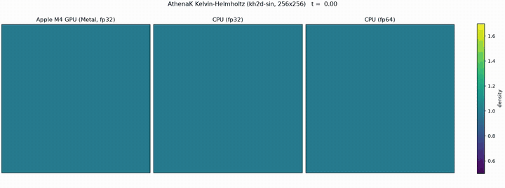
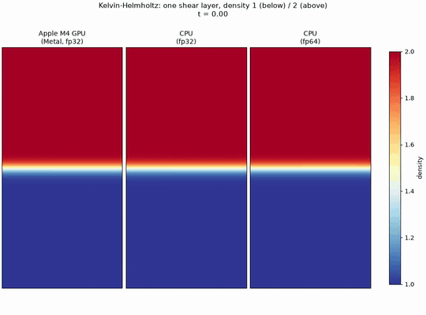

# AthenaK

Block-based AMR framework with fluid, particle and numerical relativity solvers in Kokkos.

## `MetalAthena` branch: AthenaK on Apple Silicon GPUs

This branch runs AthenaK on the GPU of Apple Silicon Macs (via Metal) by building
Kokkos's SYCL backend with [AdaptiveCpp](https://github.com/AdaptiveCpp/AdaptiveCpp).
It follows [kokkos/kokkos#9750](https://github.com/kokkos/kokkos/issues/9750) and reuses
the patches from the scaluq team's investigation
([qulacs/scaluq#463](https://github.com/qulacs/scaluq/pull/463)).
Apple GPUs have no fp64 arithmetic, so GPU runs use **single precision**.

**Status:** hydrodynamics with WENO-Z reconstruction and the HLLC Riemann solver runs on
an Apple M4 GPU. Two Kelvin-Helmholtz tests were verified. Each animation below shows the
density in three runs side by side: M4 GPU (fp32), CPU (fp32) and CPU (fp64).

**`kh2d-sin`** (256×256, random velocity perturbations, run to t = 10): about 1.5×10⁷
zone-cycles/s, roughly 11× one CPU core in fp64. Mass and energy are conserved to about
4×10⁻⁵. The GPU pattern differs from the CPU ones because the GPU random-number pool
assigns states in a different order, so the initial perturbation differs. The two CPU
runs stay nearly identical.

**`kh2d-single`** (one shear layer, density 1 below and 2 above, single-mode
perturbation, run to t = 5): the GPU run agrees point by point with the fp64 CPU run to
about 2×10⁻⁴, as closely as the fp32 CPU run does. The measured linear growth rate,
σ ≈ 1.7, matches theory for a tanh shear layer of this thickness.

The default fp64 CPU build is unaffected: the CPU test suite passes (225 passed, 15
skipped), and so do the style checks. The build recipe, run instructions and known
limitations are in [`patches/README.md`](patches/README.md).

### Changes relative to upstream AthenaK

**1. scaluq patches: used unmodified.** Two files from scaluq's `research/f2-metal`
branch are stored byte for byte in `patches/`:
- `kokkos-5.2.0-acpp-metal.patch` (Kokkos, about 350 lines in 24 files)
- `adaptivecpp-metal-num-subgroups.patch` (adds a missing Metal builtin to
  AdaptiveCpp; it is applied when building the compiler, not in this repo)

**2. Kokkos**
- The submodule moves from **4.7.02 to 5.2.0**, the version scaluq's patch targets.
  Kokkos 5 needs C++20, so AthenaK now builds with C++20.
- scaluq's patch makes the SYCL backend build with AdaptiveCpp and run correctly on
  Metal: device-code detection, fixed work-group sizes, two-pass reductions and scans,
  and replacements for DPC++-only APIs. It is applied only with
  `-DAthena_ENABLE_ACPP_METAL=ON`.
- `kokkos-5.2.0-dualview-public.patch` is a one-line local change that keeps
  `DualView::d_view`/`h_view` public. Kokkos 5.2 made them private
  (kokkos#7716, #8980), and AthenaK uses them extensively. This is a stopgap until
  AthenaK moves to `view_device()`/`view_host()`. It is applied to all builds.
- `Kokkos_ENABLE_DEPRECATED_CODE_4=ON` keeps `View::HostMirror`.
- CMake applies these patches to the submodule's working tree at configure time. The
  submodule itself records only the 5.2.0 version.

**3. AthenaK**
- **Build:** a new `Athena_ENABLE_ACPP_METAL` option turns on the SYCL backend, forces
  single precision and applies the scaluq patch. `athena.hpp` now includes `<cfloat>`.
- **Single-precision compile fixes:** cherry-picked from the `single_precision` branch of
  davidvelasco07/athenak (about 510 of roughly 540 errors). The remaining 27 errors are
  float/double mismatches, fixed here.
- **Single-precision bug in WENO-Z:** the epsilon `1e-42` overflows in float and gave
  NaN after one step. Single-precision builds now use `1e-14`; fp64 is unchanged.
- **No fp64 inside GPU kernels:** bare double literals such as `0.5` are written as
  `Real(0.5)`, which is a no-op when `Real` is `double`. This is done in the code used
  by hydro with WENO-Z and HLLC (the HLLC solver, WENO-Z, EOS, hydro update and flux
  code, history output, the KH problem generator and the hydro boundary conditions).
  Team scratch levels are now `constexpr` at 17 sites, avoiding a pointer-select
  error in Metal's shader compiler (AdaptiveCpp#2313).
- **New test setup:** `iprob=1` in `pgen/fluids/kh.cpp` takes optional
  `rho_bot`/`rho_top` for a density contrast (both default to 1, so existing inputs are
  unchanged). A new input file is `inputs/hydro/kh2d-single.athinput`.

**Not done yet:** MHD, GR/SR, radiation, z4c, and the other reconstruction methods and
Riemann solvers still contain double literals and will abort on the GPU until they get
the same treatment. To find such literals, compile the fp32 CPU build with
`clang++ -Wdouble-promotion`, or run with `ACPP_DEBUG_LEVEL=3` to see which kernel fails.
One upstream issue is left alone: `kh.cpp` does not initialise the passive scalar for
`iprob=3`.

## Overview

AthenaK is a complete rewrite of the AMR framework and fluid solvers in the [Athena++](https://github.com/PrincetonUniversity/athena) astrophysical MHD code using the [Kokkos](https://kokkos.org/) programming model.  Note that Athena++ is itself an extension of the original C-version of
[Athena](https://github.com/PrincetonUniversity/Athena-Cversion).

Using Kokkos enables *performance-portability*.  AthenaK will run on any hardware supported by Kokkos, including CPU, GPUs from various vendors, and ARM processors.

AthenaK is targeting challenging problems that require exascale resources, and as such it does not implement all of the features of Athena++.  Current code features are:
- Block-based AMR with dynamical execution via a task list
- Non-relativistic (Newtonian) hydrodynamics and MHD
- Special relativistic (SR) hydrodynamics and MHD
- General relativistic (GR) hydrodynamics and MHD in stationary spacetimes
- Relativistic radiation transport
- Lagrangian tracer particles, and charged test particles
- Numerical relativity solver using the Z4c formalism
- GR hydrodynamics and MHD in dynamical spacetimes

The numerical algorithms implemented in AthenaK are all based on higher-order finite volume methods with a variety of reconstruction algorithms, Riemann solvers, and time integration methods.

AthenaK was developed in conjunction with the 
[Parthenon AMR framework](https://github.com/parthenon-hpc-lab/parthenon) and borrows many features
from that effort. It is also closely related to the 
[AthenaPK MHD code](https://github.com/parthenon-hpc-lab/athenapk), which is another implementation
of Athena++ based on the Parthenon framework.

## Getting Started

See the [Documentation](https://ias-astrophysics.github.io/athenak-docs) to get started.

In particular, see the complete list of [requirements](https://ias-astrophysics.github.io/athenak-docs/requirements.html), or
instructions on how to [download](https://ias-astrophysics.github.io/athenak-docs/download.html) and [build](https://ias-astrophysics.github.io/athenak-docs/build.html) the code for various devices.
Other pages give instructions for running the code.

Since AthenaK is very similar to Athena++, the [Athena++ documention](https://github.com/PrincetonUniversity/athena/wiki) may also be helpful.

## Tutorials ##

A seperate GitHUb repo contains a variety of [Tutorials](https://github.com/IAS-Astrophysics/athenak-gallery) with detailed instructions on how to use AthenaK to solve specific problems.

## Code papers

For more details on the features and algorithms implemented in AthenaK, see the code papers:
- [Stone et al (2024)](https://ui.adsabs.harvard.edu/abs/2024arXiv240916053S/abstract): basic framework
- [Zhu et al. (2024)](https://ui.adsabs.harvard.edu/abs/2024arXiv240910383Z/abstract): numerical relativity solver
- [Fields at al. (2024)](https://ui.adsabs.harvard.edu/abs/2024arXiv240910384F/abstract): GR hydro and MHD solver in dynamical spacetimes

Please reference these papers as appropriate for any publications that use AthenaK.
